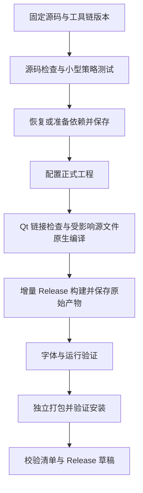

# Regram 正式编译流程规划与失败恢复说明

更新日期：2026-10-12。适用分支：`regram`。目标平台：macOS Apple Silicon、macOS Intel、Windows x64、Linux x64。本轮检查和安装包均使用 Release。

目标是先用小规模检查发现编译、链接和环境错误，再执行完整构建；失败后复用已经完成的工作。需要同时补上原生平台检查、客户端编译缓存和独立打包，单纯增加重试次数无法解决时间浪费。

## 1. 当前为什么反复浪费时间

最新 [Windows 38171024897](https://github.com/RegramDev/Regram-desktop/actions/runs/38171024897) 已完成源码编译，在 `2924/2925` 链接 `Regram.exe` 时以 `LNK1102: out of memory` 退出。末尾链接持续约 19 分钟；之后的字体、安装和上传步骤被跳过。这次不是超时，也不是启动崩溃。依赖准备约 2 小时 11 分、缓存保存约 24 分、应用配置及构建约 2 小时 27 分，成功保存了约 11.1 GB 依赖缓存。

失败命令使用 x64 链接器和 `/DEBUG`，后者相当于合并完整 PDB。Windows 分发工作流现在设置空的 `CMAKE_MSVC_DEBUG_INFORMATION_FORMAT`，沿用仓库已有逻辑生成 `/DEBUG:NONE`，保留 `/O2` 优化并跳过符号合并。完整编译前执行 `check_windows_release.py`，检查优化、目标架构、原生 x64 链接器和实际生成的符号参数；检查失败即停止。日志补充可用物理／虚拟内存和磁盘空间。这个检查能发现错误配置，不能证明 runner 内存足够。

[Windows 单平台重跑 38191607882](https://github.com/RegramDev/Regram-desktop/actions/runs/38191607882) 已命中依赖缓存：下载与解压 5 分 23 秒，依赖准备 1 秒，缓存保存因精确命中而跳过；当前正在构建应用。此前应用对象没有持久保存，不能从上一次失败点直接恢复链接。缓存尚未预热时的耗时不能作为此次依赖复用耗时。

已用仓库实际 `cmake/options_win.cmake` 在小型 CMake 工程生成并比较两组 Release 链接参数：旧符号配置生成 `/DEBUG` 并被前置检查拒绝，分发配置生成 `/DEBUG:NONE` 并通过。原生 Windows 全量重跑仍需验收，不能提前宣布内存错误已解决。PDB 调试符号不再由此分发工作流生成；需要诊断符号时使用独立构建。链接错误没有 `/LTCG`，所以没有把降低 LTO 线程数当作本次修复。

以下为此前构建的历史问题：

以下是本次实际日志中的问题，可以分别在流程的不同位置提前发现。

| 构建 | 实际失败点 | 应提前在哪里发现 |
| --- | --- | --- |
| [Windows 38101297163](https://github.com/RegramDev/Regram-desktop/actions/runs/38101297163) | `1897/2921`，`api_who_reacted.cpp` 未使用 `owner`，MSVC C4189 | 用正式 MSVC 参数检查涉及的源文件 |
| [Windows 38109979859](https://github.com/RegramDev/Regram-desktop/actions/runs/38109979859) | `2869/2921`，`window_filters_menu.cpp` 未使用 `settings`，MSVC C4189 | 检查本次修改及尚未通过原生检查的移植文件 |
| [Windows 38123487936](https://github.com/RegramDev/Regram-desktop/actions/runs/38123487936) | `2920/2921`，链接 Qt Network 时缺少 DNS 系统函数，LNK2019/LNK1120 | 在完整客户端之前链接一个使用相同 Qt 依赖的小程序 |
| 同轮远端 Intel Mac | 超过 GitHub 作业设置的 6 小时上限 | 将依赖准备与应用构建拆成独立作业，保留完成的阶段 |

此前 Windows 38123487936 完成了全部 C++ 编译。依赖准备耗时约 **1 小时 26 分**，缓存保存约 **9 分钟**，应用构建约 **2 小时 5 分**，其中末尾链接约 **31 分钟**。

最后缺少的符号是 `DnsQueryEx`、`DnsWriteQuestionToBuffer_W` 和 `DnsExtractRecordsFromMessage_W`。失败日志的链接参数没有 `dnsapi`；Microsoft 文档明确列出 `DnsQueryEx` 的导入库为 [Dnsapi.lib](https://learn.microsoft.com/en-us/windows/win32/api/windns/nf-windns-dnsqueryex)。应在 Windows 的 Qt 依赖封装中补齐该依赖，并通过小规模链接检查验证。

前两处未使用变量已清理。本轮已在 `Telegram/cmake/regram.cmake` 的 Windows 分支把 `dnsapi` 加入 `external_qt` 的接口依赖，供客户端、字体工具等目标继承。按当前要求不执行编译，原生链接验证仍待后续构建完成，不能把“所有 C++ 编译通过”视为安装包构建完成。

## 2. 已完成与待实现

| 项目 | 当前状态 |
| --- | --- |
| 分平台选择构建，失败后只重跑对应平台 | 已支持 |
| macOS 两种架构使用独立 Release 目录 | 已支持 |
| Windows 完整依赖在应用构建前保存 | 已实现；最新运行已成功保存约 11.1 GB 缓存 |
| Windows Qt DNS 系统库依赖 | 最新构建已越过缺符号问题，在后续 PDB 链接阶段内存不足 |
| Windows 分发链接参数前置检查 | 已接入；本机 CMake 生成验证通过，原生重跑待验收 |
| 客户端逐个源文件的编译结果缓存 | 待实现；现有 Windows 工作流没有启用 |
| Qt 与系统库的小规模链接检查 | 待实现 |
| 对变更及受影响源文件执行原生快速编译 | 待实现；已有人工单文件检查，尚未自动化 |
| 原始构建产物先保存，再独立打包 | 待实现；目前打包失败会导致整项作业失败 |
| 字体、安装和独立目录启动检查 | 已支持；应用构建成功后才会执行 |

完整依赖缓存解决的是 Qt、WebRTC 等依赖重复编译；客户端编译缓存解决的是约 2900 个应用构建项反复执行。两者需要分别处理。

## 3. 每次正式构建的顺序



| 阶段 | 执行内容 | 通过条件 |
| --- | --- | --- |
| 源码检查 | 检查差异、子模块补丁、Python/配置文件语法，以及相关小型策略测试 | 没有语法、补丁或策略错误 |
| 依赖准备 | 校验架构、Qt、SDK、编译器与依赖指纹；缺少时准备；成功后立即保存 | 必需依赖存在且版本一致 |
| 原生快速检查 | 使用本平台正式编译参数检查受影响文件，并链接 Qt 小程序 | 编译和链接均通过 |
| 完整 Release | 复用编译缓存与已有构建目录，构建 `Telegram` 目标 | `Regram` 可执行文件成功生成 |
| 运行验证 | 检查字体、独立目录启动及本次修改涉及的功能 | 基础启动和相关回归通过 |
| 打包与安装 | 使用保存的原始产物制作包，检查安装结果、架构、SHA-256 与源码清单 | 安装和产物校验通过 |

快速检查必须在完整构建之前执行。首次预热依赖和生成头文件仍可能较慢；缓存预热以后，再测量快速阶段的耗时目标。

### 源码与版本固定

发布前检查 Telegram Desktop 最新稳定版及 `dev` 分支；存在适用更新时先同步、解决冲突并完成相关验证，再固定发布提交。不能以旧 `master` 分支替换当前新版本基线。

每个平台记录：源码提交、子模块版本与补丁摘要、架构、Qt、编译器、SDK、构建配置和关键参数。正式构建启动后，使用固定提交或隔离源码目录，避免中途移动源码导致产物与清单不一致。

API 配置继续使用被 Git 忽略的 `.local/regram/api.cmake` 或 Actions Secrets。说明、日志摘要和发布附件中不填写实际 API hash。

### 快速原生编译

Windows 必须使用当前正式环境：MSVC 14.44、SDK 10.0.26100.0、ATL、x64、Qt 6.11.2，并保留 `/W4`、`/WX` 和 Release 条件。macOS 的 Clang 检查能提前发现部分错误，Windows 最终仍需 MSVC 验证。

选择变更文件时，同时检查相关头文件、平台分支及生成文件的影响。修改 `.h`、`.style`、语言字符串、TL schema 或公共构建配置时，检查范围必须扩展到依赖它们的编译单元。首次导入或大规模移植要建立全部相关文件的原生检查基线，避免仅检查最后一处修复。

Windows 和 Linux 的 Ninja 工程可导出 `compile_commands.json`，用于获得实际编译参数和源文件映射。CMake 的该功能仅适用于 Makefile/Ninja，现有 macOS Xcode 树不能直接使用；macOS 可沿用真实 Xcode 编译记录，或另建经过验证的 Ninja 检查树。[CMake 官方说明](https://cmake.org/cmake/help/latest/variable/CMAKE_EXPORT_COMPILE_COMMANDS.html)

编译参数、生成头文件和预编译头必须与正式工程一致。不要手写一套简化参数后把通过结果当成正式编译通过。

### Qt 小规模链接检查

新增一个独立小目标，共用正式工程的 `desktop-app::external_qt` 和必要的公共链接设置，覆盖 Qt Core、Gui、Widgets、Network 及本平台相关依赖。

Windows 的小程序必须实际引用 `QDnsLookup` 等会引入 DNS 实现的功能；仅查找 `.lib` 是否存在，或仅链接空程序，无法发现本次错误。链接验证本身不需要账号或真实网络请求。构建封装和探针都通过后，再编译完整客户端。

探针检查的是其覆盖到的依赖，完整客户端链接仍是正式构建的一部分。

## 4. 缓存应该怎样保存

| 缓存或产物 | 保存内容 | 更新时机 |
| --- | --- | --- |
| 依赖缓存 | 经过校验的 Qt、WebRTC、Rust 等所需依赖与工具 | 依赖准备成功后立即保存 |
| 编译结果缓存 | 成功编译的对象及缓存元数据 | 编译过程中保存，整体构建失败时保留成功项 |
| 原始构建产物 | 可执行文件或 `.app`、必需运行文件及来源清单 | 完整应用构建成功后保存为 artifact |
| 安装包 | DMG、setup EXE、ZIP、tar.xz、JSON、SHA-256 | 打包与安装验证成功后上传 |

依赖缓存的键包含平台、架构、完整工具链版本、Qt、配置、依赖准备参数和补丁指纹。应用代码修改不应无条件使所有依赖缓存失效。

GitHub 现有缓存条目不能用同一个键覆盖更新，因此不完整旧缓存必须通过新键迁移。当前 Windows 的 `ready-v2` 已完成这次迁移。缓存与 artifact 的用途也不同：前者帮助复用，后者保存某次构建的确定产物。[GitHub 缓存规则](https://docs.github.com/en/actions/reference/workflows-and-actions/dependency-caching)、[缓存与 artifact 的区别](https://docs.github.com/en/actions/concepts/workflows-and-actions/dependency-caching)

客户端编译缓存建议优先试点 **sccache**。先验证 MSVC 的 PCH、调试信息和响应文件参数是否可以被缓存，并查看实际命中率；固定并记录工具版本，试点通过后再扩大覆盖。使用 CMake compiler launcher 接入时还需检查生成器支持，不能直接假定现有 Xcode 构建树也会启用缓存。[sccache 官方用法](https://github.com/mozilla/sccache#usage)

CI 可试点 sccache 的 GitHub Actions 后端，将成功编译结果持续保存；如果使用本地缓存目录，则必须在编译失败时也保存成功项，并采用可生成新条目的键。缓存命中、未命中及不支持缓存的调用数量，都写入构建摘要。[sccache Actions 后端](https://github.com/mozilla/sccache/blob/main/docs/GHA.md)

不要直接跨机器复制整个 `out/` 当成通用增量缓存，其中包含绝对路径、生成器状态和工具链信息。本地固定环境保留自己的构建目录；不同平台、架构和配置分开。

现有完整 Windows 依赖缓存约 11.1 GB，需要记录恢复时间、仓库缓存配额和驱逐情况。后续根据准备脚本实际需要裁剪重复的依赖中间产物，不能未经验证删除必要文件。

当前尚未保存 Windows 客户端对象缓存，因此下一次修复链接库后，托管 runner 仍可能重编译应用。首次启用编译缓存也需要预热，不能承诺首次重跑几分钟完成。

## 5. 哪一步失败，就从哪一步恢复

| 失败类型 | 恢复方式 |
| --- | --- |
| 源码语法或 MSVC 警告 | 一次整理本次检查范围内的全部诊断，修复后先重跑快速检查，再复用缓存构建 |
| Qt/系统库链接失败 | 修复依赖封装，先重跑小规模链接检查；已有同环境对象时仅重新链接完整应用 |
| 依赖下载或网络失败 | 重试具体下载和校验，保留已成功准备的依赖；重试次数有上限并记录原因 |
| 缓存缺失或不兼容 | 校验后恢复匹配版本；失配时准备新依赖，不用旧架构产物拼接 |
| 作业超时 | 根据各阶段耗时拆分作业；依赖准备产物应先保存，应用构建有独立时间预算 |
| 字体下载失败 | 重试对应字体下载与校验，复用原始 Release 产物 |
| DMG/Inno Setup/压缩失败 | 从保存的原始产物重跑打包，不重编译客户端 |
| 安装或启动失败 | 保存崩溃和运行日志，定位依赖或代码原因；修复后执行相关构建与验证 |

上表的“仅重新链接”和“仅重新打包”以相应对象或原始产物仍可用为前提。当前一体式作业还没有全部这些恢复能力。

同一环境的本地构建通常通过重新执行原构建命令增量恢复。不要例行删除整个构建目录或执行 clean；仅在有明确的产物失配证据时处理对应目录，涉及便携账号目录时先备份。

## 6. 可以直接使用的现有命令

下面从仓库根目录执行。依赖和对应工程须已配置完成；新增自动检查目标另见第 7 节的实施顺序。

### 小型策略测试：Release

macOS Apple Silicon 已安装 CMake、Ninja 和 Homebrew ICU 时：

```sh
git diff --check
python3 Telegram/build/regram/apply_patches.py
cmake -S Telegram/SourceFiles/regram/tests -B .cache/regram/policy-release \
  -G Ninja -DCMAKE_BUILD_TYPE=Release -DICU_ROOT=/opt/homebrew/opt/icu4c
cmake --build .cache/regram/policy-release --parallel 2
ctest --test-dir .cache/regram/policy-release --output-on-failure
```

该独立测试检查策略行为；UI、Qt 链接和原生平台编译仍按后续阶段验证。其他机器使用实际 ICU 安装位置。

### Windows：检查这次出错的编译单元

在已初始化的正式 MSVC 环境中，`out` 是已经配置好的 Ninja Multi-Config 树：

```powershell
ninja -C out -f build-Release.ninja -t targets all |
  Select-String 'api_who_reacted.cpp.obj|window_filters_menu.cpp.obj'

cmake --build out --config Release --parallel 2 --target `
  Telegram/CMakeFiles/Telegram.dir/Release/SourceFiles/api/api_who_reacted.cpp.obj `
  Telegram/CMakeFiles/Telegram.dir/Release/SourceFiles/window/window_filters_menu.cpp.obj
```

对象目标名称以该工程生成的 Ninja 图为准。首次执行仍需满足生成头文件、PCH 等前置依赖，故不能按普通单文件编译估算冷启动时间。

快速检查通过后执行正式目标：

```powershell
cmake --build out --config Release --target Telegram --parallel 4
```

### macOS：复用现有 Release 工程

```sh
export DEVELOPER_DIR=/Applications/Xcode.app/Contents/Developer
cmake --build .local/regram/release/app-build \
  --config Release --target Telegram --parallel 4 -- -arch arm64
cmake --build .local/regram/release-intel/app-build \
  --config Release --target Telegram --parallel 4 -- -arch x86_64
```

只运行本次受影响架构的命令。普通应用源码修改直接复用应用构建树；依赖或工具链变动时再运行 `build_macos_release.py` 的完整流程。新增源码或 `.style` 后须先重新配置现有工程；按仓库说明取消导出的 `QT`，保留该树已有版本。

已有验证产物的打包命令见 [构建与打包指南](building.md)。打包输出使用新的目录，避免覆盖已经交付的安装包。

### 单平台正式工作流

确认对应源码快速检查已通过后，再触发需要的平台：

```sh
gh workflow run regram-release.yml \
  --repo RegramDev/Regram-desktop --ref regram -f platform=windows
```

当前可选 `windows`、`linux`、`macos-intel`、`all`；Apple Silicon 使用本地独立 Release 构建。公共代码变化需分析受影响平台，无法证明不受影响时扩大构建范围；Windows 专属链接修复可保留已验证的 Linux/macOS 包及其原始来源清单。

## 7. 实施顺序与验收

| 优先级 | 具体工作 | 验收标准 |
| --- | --- | --- |
| P0 | DNS 依赖已补入；接着新增共用正式链接设置的小目标 | 小目标能复现缺库错误，补齐后通过，再执行完整客户端 |
| P0 | 自动收集变更及受影响源文件，增加 MSVC Release 快速检查 | 已知 C4189 问题在快速阶段被拦住；范围分析覆盖头文件与生成文件变化 |
| P1 | Windows 试点 sccache，保存成功对象，即使后续链接失败也保留 | 同一提交重跑出现实际命中，修改少量源文件后未改文件复用；命中统计可查 |
| P1 | 应用构建成功后保存原始产物，把运行验证和打包拆成后续阶段 | 仅重跑打包时不调用客户端编译；来源与校验一致 |
| P2 | 分离依赖准备作业并校验依赖指纹，控制缓存体积 | 应用失败不损失依赖；缓存缺失可重建；恢复时间和版本摘要可查 |
| P2 | 分别测量并完善四个平台的增量流程 | 每个平台至少有一次冷启动及两次复用构建数据，形成实际耗时基线 |

每次构建摘要记录各阶段耗时、缓存命中情况、源码提交、产物架构、失败阶段和完整日志位置。缓存预热后的源码检查以 1～5 分钟、小规模链接以 1～5 分钟、少量源文件原生检查以 5～15 分钟为初期目标，必须用实际结果校正；完整编译、链接和签名分别计时。

发布前仍需检查安装、独立目录启动及本次变更对应的功能。字体检查、12 秒启动检查和构建成功各有覆盖范围；涉及滚动或设置卡顿时，还需使用经过授权的真实数据或副本做性能回归。

本文件是流程规划。第 2 节标记为“待实现”的机制尚未接入当前工作流，其完成以第 7 节的实际验收为准。
